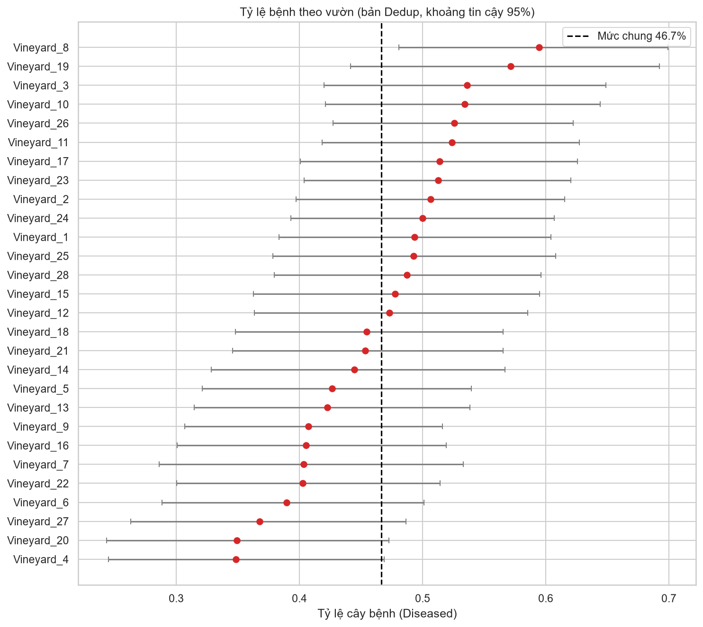
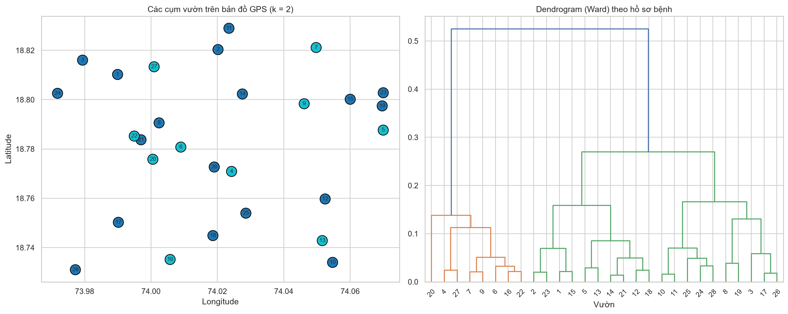
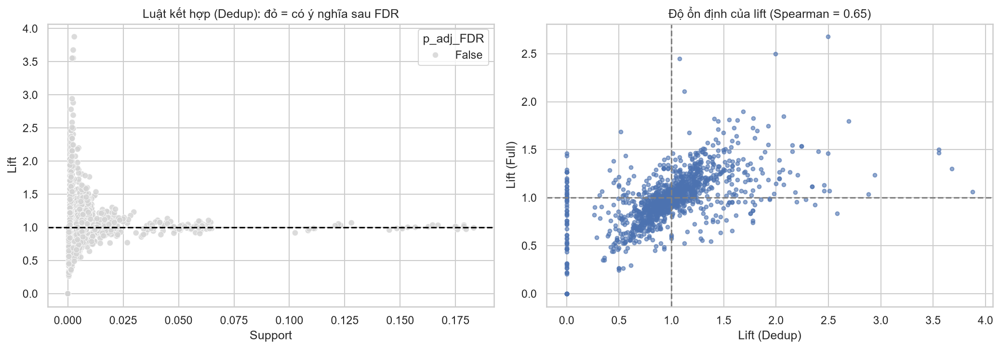
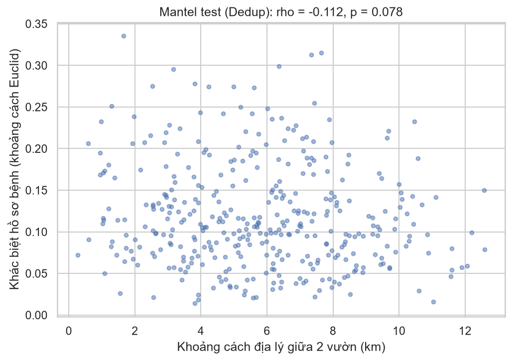
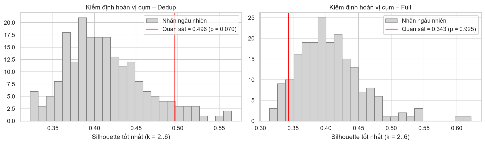
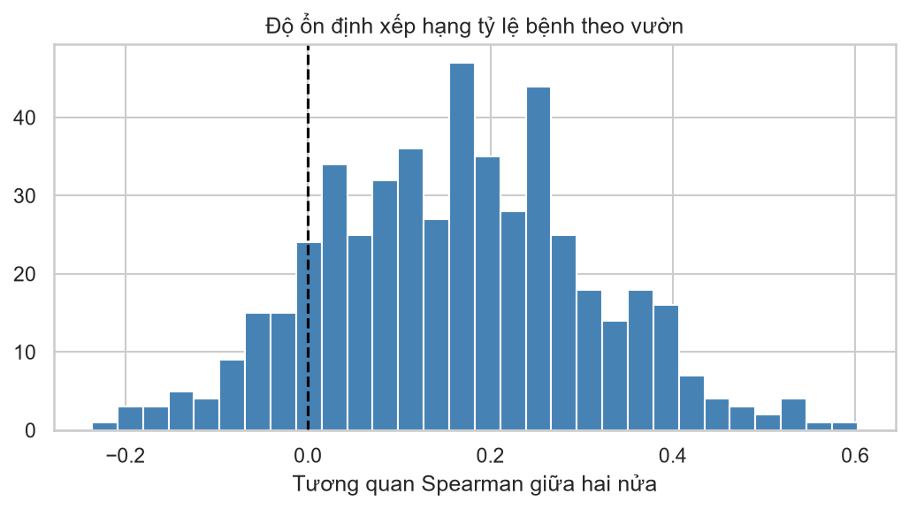
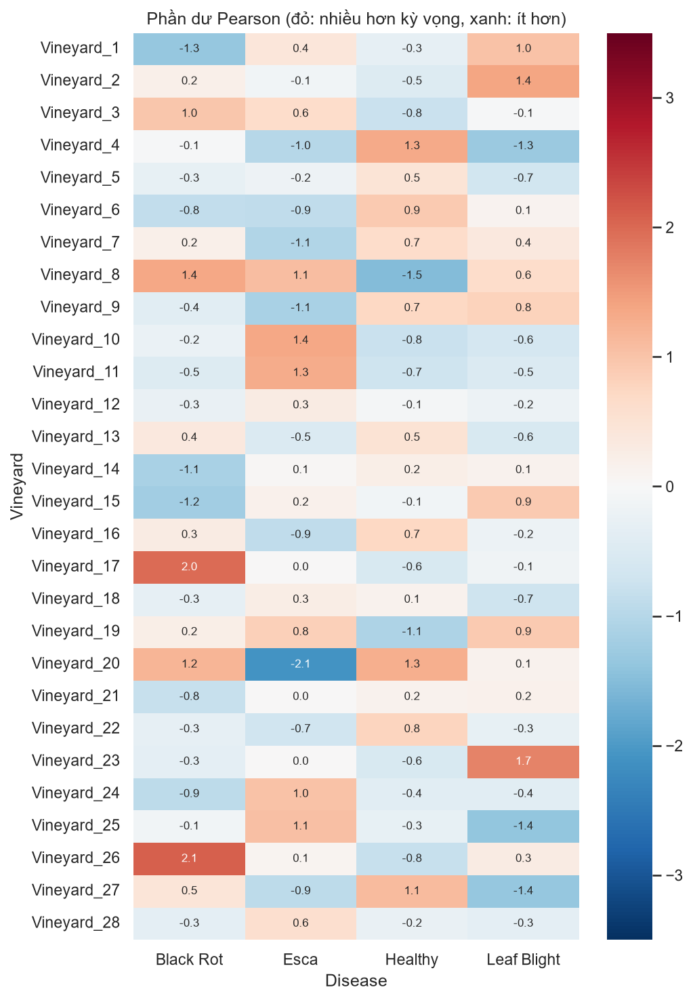

<!-- ============================================================ -->
<!-- 1. HEADER & BADGES                                           -->
<!-- ============================================================ -->

<h1 align="center">🍇 Smart-Vineyard</h1>

<p align="center">
  <b>Dự án Khai phá dữ liệu phân loại bệnh lá nho và đánh giá tác động môi trường / metadata trên tập dữ liệu GVLiD.</b>
</p>

<p align="center">
  
  
  
  
  
  
  
</p>

---

<!-- ============================================================ -->
<!-- 2. TABLE OF CONTENTS                                         -->
<!-- ============================================================ -->

## 📑 Table of Contents

1. [About The Project](#-about-the-project)
2. [Tech Stack](#-tech-stack)
3. [Repository Structure](#-repository-structure)
4. [Getting Started / Installation](#-getting-started--installation)
5. [Notebook Pipeline & Usage](#-notebook-pipeline--usage)
6. [Key Results & Outputs](#-key-results--outputs)
7. [Contributors & Acknowledgments](#-contributors--acknowledgments)

---

<!-- ============================================================ -->
<!-- 3. ABOUT THE PROJECT                                         -->
<!-- ============================================================ -->

## 🌿 About The Project

### Đặt vấn đề

Bệnh trên lá nho là một trong những nguyên nhân chính gây suy giảm năng suất và chất lượng nho trên toàn cầu. Việc phát hiện sớm và chính xác loại bệnh thông qua hình ảnh lá nho mang lại tiềm năng lớn cho nông nghiệp thông minh. Tuy nhiên, hầu hết các nghiên cứu hiện tại chỉ dừng lại ở việc huấn luyện mô hình phân loại mà **bỏ qua hai vấn đề quan trọng**:

1.  **Chất lượng dữ liệu:** Các bộ dữ liệu ảnh thực tế thường chứa một lượng lớn ảnh trùng lặp (> 31% trong GVLiD), gây rò rỉ dữ liệu (data leakage) và thổi phồng kết quả đánh giá.
2.  **Ảnh hưởng của metadata:** Các yếu tố ngoại cảnh (vị trí vườn, thời tiết, ánh sáng) gắn liền với metadata có thể vô tình tạo ra "đường tắt" (shortcut) cho mô hình, khiến nó học điều kiện chụp thay vì triệu chứng bệnh thật sự.

### Mục tiêu

**Smart-Vineyard** kết hợp **mô hình phân loại bệnh lá nho** trên tập dữ liệu **GVLiD** (Grapevine Leaf identification of Disease) với các **phương pháp kiểm định thống kê chuyên sâu** để đánh giá ảnh hưởng từ siêu dữ liệu (metadata) của vườn nho. Cụ thể:

| Bài toán | Mô tả | Phương pháp chính |
|:---:|---|---|
| **Task 1** | Phân loại 4 trạng thái lá nho (Healthy, Black Rot, Esca, Leaf Blight) từ hình ảnh | Trích đặc trưng thủ công (HSV, GLCM, Hu Moments) → 8 mô hình ML cổ điển + Transfer Learning CNN (ResNet-18) |
| **Task 2** | Phân tích mối liên hệ giữa phân bố bệnh với các yếu tố môi trường & vị trí vườn | Gom cụm vườn (K-Means, Ward), luật kết hợp, kiểm định thống kê (Wilson, Mantel, Fisher, hoán vị Chi-square) |

### Tập dữ liệu GVLiD ở một cái nhìn

| Chỉ số | Giá trị |
|---|---|
| Tổng bản ghi thô | 3.476 ảnh + metadata |
| Ảnh trùng lặp phát hiện | ~31% (MD5 + dHash) |
| **Ảnh độc lập sau khử trùng** | **2.047** |
| Số vườn nho | 28 vườn (Ấn Độ) |
| Thiết bị chụp | Redmi Note 10 5G (Sony IMX 582) |

| Lớp | Mô tả | Số ảnh (sau dedup) | Tỷ lệ |
|:---:|---|---:|---:|
| 🟢 Healthy | Lá khỏe mạnh | 1.092 | 53,3 % |
| 🟤 Esca | Bệnh Esca (sởi / khô vằn lá) | 707 | 34,5 % |
| 🟡 Leaf Blight | Bệnh cháy lá | 152 | 7,4 % |
| ⚫ Black Rot | Bệnh thối đen | 96 | 4,7 % |

> ⚠️ **Mất cân bằng cực nặng** — lớp `Black Rot` chỉ chiếm 4,7 % tổng ảnh thật. Một mô hình đoán sai toàn bộ `Black Rot` vẫn đạt > 90 % Accuracy. Do đó **Macro F1** và **Balanced Accuracy** được chọn làm thước đo chính.

---

<!-- ============================================================ -->
<!-- 4. TECH STACK                                                -->
<!-- ============================================================ -->

## 🛠️ Tech Stack

| Nhóm | Công nghệ |
|---|---|
| **Ngôn ngữ** | Python 3.8+ |
| **Xử lý dữ liệu** | Pandas · NumPy · JSON |
| **Thống kê & Kiểm định** | SciPy (Kruskal–Wallis, Fisher, Mantel, hoán vị) · Statsmodels |
| **Học máy cổ điển** | Scikit-learn (SVM, Random Forest, KNN, MLP, Extra Trees, HistGBT, Logistic Regression, Decision Tree) |
| **Học sâu** | PyTorch · TorchVision (ResNet-18 Transfer Learning) |
| **Xử lý ảnh** | OpenCV · Pillow · scikit-image (GLCM) |
| **Trực quan hóa** | Matplotlib · Seaborn |
| **Hashing & Dedup** | MD5 (hashlib) · dHash (perceptual hashing) |
| **Công cụ** | Jupyter Notebook · Git |

---

<!-- ============================================================ -->
<!-- 5. REPOSITORY STRUCTURE                                      -->
<!-- ============================================================ -->

## 📂 Repository Structure

```text
Smart-Vineyard/
│
├── Dataset/                                # Tập dữ liệu GVLiD và metadata
│   ├── GVLiD GrapeVine Leaf .../           #   ├── Thư mục ảnh gốc (4 lớp bệnh)
│   │   └── DATASET/
│   │       ├── Black rot/
│   │       ├── Esca/
│   │       ├── Healthy/
│   │       ├── Leaf Blight/
│   │       └── metadata.json               #   └── Siêu dữ liệu gốc (vườn, GPS, thời tiết…)
│   └── DataSource.txt                      #   Link tải dataset Mendeley
│
├── Notebook/                               # 5 Jupyter Notebooks chạy tuần tự
│   ├── 01_EDA.ipynb                        #   Bước 1: Khám phá & tiền xử lý dữ liệu
│   ├── 02_DataMatching.ipynb               #   Bước 2: Ghép ảnh ↔ metadata & phát hiện bất thường
│   ├── 03_Image_Preprocessing.ipynb        #   Bước 3: Khử trùng, chia tập, trích đặc trưng, kiểm định
│   ├── Task01_Grape_Leaf_Disease_          #   Bước 4: Phân loại bệnh (ML cổ điển + Deep Learning)
│   │       Classification.ipynb
│   └── Task02_Analysis of Disease          #   Bước 5: Phân bố bệnh & mối liên hệ môi trường
│           Distribution and Environmental
│           Associations.ipynb
│
├── outputs/                                # Biểu đồ, bảng thống kê & kết quả thực nghiệm
│   ├── processed/                          #   Dữ liệu đã xử lý qua các bước
│   │   ├── image_metadata.json             #     3.476 bản ghi ảnh đã ghép metadata
│   │   ├── metadata_without_image.csv      #     Bản ghi metadata không khớp ảnh
│   │   ├── skipped_files.csv               #     Các file bị bỏ qua
│   │   └── step03_clean/                   #     Dữ liệu sạch cho 2 bài toán
│   │       ├── preprocessing_config.json   #       Cấu hình, class weights, RGB stats
│   │       ├── task1_images_split.csv      #       2.047 ảnh + split + fold
│   │       ├── task1_handcrafted_          #       25 đặc trưng thủ công
│   │       │       features.csv
│   │       ├── task2_env_full.csv          #       Dữ liệu môi trường (2.904 bản ghi)
│   │       └── task2_env_dedup.csv         #       Phiên bản khử trùng
│   │
│   ├── bai1/                               #   Kết quả Task 1 (Phân loại bệnh)
│   │   ├── ml_models/                      #     Mô hình đã huấn luyện (.joblib)
│   │   │   ├── best_traditional_ml.joblib
│   │   │   └── all_models/                 #       9 mô hình ML cổ điển
│   │   ├── best_resnet18_gvlid.pt          #     Mô hình ResNet-18 (Deep Learning)
│   │   ├── bai1_ket_qua_5fold_cv.csv       #     Bảng kết quả 5-Fold CV
│   │   ├── bai1_ket_qua_holdout_test.csv   #     Bảng kết quả Hold-out Test
│   │   └── *.png                           #     Biểu đồ phân tích
│   │
│   └── bai2/                               #   Kết quả Task 2 (Phân bố & môi trường)
│       └── *.png                           #     Biểu đồ phân tích
│
├── test_images/                            # Ảnh lá nho mẫu để demo dự đoán
├── CommandToRunML.txt                      # Hướng dẫn chạy dự đoán qua CLI
├── requirements.txt                        # Danh sách thư viện cần cài đặt
└── README.md                               # Tài liệu hướng dẫn dự án (file này)
```

---

<!-- ============================================================ -->
<!-- 6. GETTING STARTED / INSTALLATION                            -->
<!-- ============================================================ -->

## 🚀 Getting Started / Installation

### Prerequisites

| Yêu cầu | Phiên bản |
|---|---|
| Python | ≥ 3.8 |
| Git | Bất kỳ bản ổn định |
| GPU *(tùy chọn — chỉ cần cho Deep Learning ở Task 1, mục 8–9)* | CUDA-compatible |

### Các bước cài đặt

**1. Clone repository**

```bash
git clone https://github.com/<your-username>/Smart-Vineyard.git
cd Smart-Vineyard
```

**2. Tạo môi trường ảo**

<details>
<summary><b>Dùng <code>venv</code> (khuyến nghị)</b></summary>

```bash
# Tạo môi trường ảo
python -m venv .venv

# Kích hoạt (Windows)
.venv\Scripts\activate

# Kích hoạt (macOS / Linux)
source .venv/bin/activate
```

</details>

<details>
<summary><b>Dùng <code>conda</code></b></summary>

```bash
conda create -n smart-vineyard python=3.10 -y
conda activate smart-vineyard
```

</details>

**3. Cài đặt các thư viện**

```bash
pip install -r requirements.txt
```

**4. Tải dataset GVLiD**

Tải bộ dữ liệu từ [Mendeley Data](https://data.mendeley.com/datasets/wkymf8bhcg/3) và giải nén vào thư mục `Dataset/`.

```bash
# Cấu trúc sau khi giải nén:
# Dataset/GVLiD GrapeVine Leaf .../DATASET/
#   ├── Black rot/
#   ├── Esca/
#   ├── Healthy/
#   ├── Leaf Blight/
#   └── metadata.json
```

**5. Chạy Notebook**

```bash
jupyter notebook
# Mở thư mục Notebook/ và chạy tuần tự từ 01 → Task02
```

> ⚠️ **Lưu ý:** Các notebook sử dụng đường dẫn tuyệt đối `D:\DataMining26\Smart-Vineyard`. Nếu chạy trên máy khác, hãy **sửa biến `PROJECT_DIR`** ở cell đầu tiên của mỗi notebook cho phù hợp.

---

<!-- ============================================================ -->
<!-- 7. NOTEBOOK PIPELINE & USAGE                                 -->
<!-- ============================================================ -->

## 📓 Notebook Pipeline & Usage

Dự án được thiết kế theo pipeline **5 bước tuần tự**. Mỗi notebook đọc đầu ra của notebook trước, do đó **phải chạy đúng thứ tự**.

### Tổng quan pipeline

```text
 ┌─────────────┐    ┌─────────────┐    ┌──────────────────┐    ┌────────────┐    ┌────────────┐
 │  01_EDA     │───▶│  02_Data    │───▶│  03_Image        │─┬─▶│  Task 01   │    │  Task 02   │
 │  Khám phá & │    │  Matching   │    │  Preprocessing   │ │  │  Phân loại │    │  Phân bố & │
 │  Tiền xử lý │    │  Ghép dữ   │    │  Khử trùng &     │ │  │  bệnh     │    │  Môi trường│
 │             │    │  liệu      │    │  Kiểm định       │ └─▶│            │    │            │
 └─────────────┘    └─────────────┘    └──────────────────┘    └────────────┘    └────────────┘
       ①                  ②                    ③                    ④                  ⑤
```

| Bước | Notebook | Mô tả tóm tắt | Đầu ra chính |
|:---:|---|---|---|
| ① | `01_EDA.ipynb` | Khám phá & tiền xử lý dữ liệu | Báo cáo EDA, phát hiện 31% ảnh trùng |
| ② | `02_DataMatching.ipynb` | Ghép ảnh ↔ metadata & phát hiện bất thường | `image_metadata.json` (3.476 bản ghi) |
| ③ | `03_Image_Preprocessing.ipynb` | Khử trùng, chia tập, trích đặc trưng, kiểm định thống kê | `task1_*.csv`, `task2_*.csv`, `preprocessing_config.json` |
| ④ | `Task01_...Classification.ipynb` | Phân loại bệnh (ML cổ điển + Deep Learning) | 9 mô hình `.joblib`, `best_resnet18_gvlid.pt`, biểu đồ |
| ⑤ | `Task02_...Associations.ipynb` | Phân tích phân bố bệnh & mối liên hệ môi trường | Biểu đồ gom cụm, luật kết hợp, kiểm định |

---

### ① `01_EDA.ipynb` — Khám phá & Tiền xử lý dữ liệu

**Mục tiêu:** Nạp dữ liệu GVLiD, kiểm tra cấu trúc tổng quan, phát hiện các vấn đề chất lượng dữ liệu và trực quan hóa phân phối các lớp bệnh.

**Nội dung chi tiết:**

- Nạp toàn bộ ảnh từ 4 thư mục bệnh, đếm số lượng và kiểm tra định dạng file.
- Kiểm tra **missing values** trong metadata (`metadata.json`): giá trị null, chuỗi rỗng, bất thường.
- Trực quan hóa **phân phối các lớp bệnh** (bar chart, pie chart) → phát hiện mất cân bằng.
- Khảo sát phân phối metadata: vườn nho, thời điểm chụp, ánh sáng, thời tiết, thiết bị.
- **Phát hiện quan trọng:** ~31% bản ghi là ảnh trùng lặp (1 ảnh xuất hiện nhiều lần với metadata khác nhau).

```bash
# Chạy notebook
jupyter notebook Notebook/01_EDA.ipynb
```

> 📌 Các số liệu ở notebook này tính trên **bản ghi thô** (kể cả trùng). Kết luận được kiểm tra lại trên dữ liệu đã khử trùng ở bước ③.

---

### ② `02_DataMatching.ipynb` — Ghép dữ liệu ảnh ↔ Metadata

**Mục tiêu:** Thu thập danh sách ảnh từ 4 thư mục, đọc & chuẩn hóa metadata, ghép từng ảnh với bản ghi metadata tương ứng, kiểm tra tính toàn vẹn.

**Nội dung chi tiết:**

- Thu thập danh sách ảnh từ 4 thư mục bệnh (Black Rot, Esca, Healthy, Leaf Blight).
- Đọc `metadata.json` gốc, chuẩn hóa cấu trúc và ghép với ảnh theo **quy tắc đánh số GVLiD** (Sr_No ↔ Image_Number).
- Kiểm tra các **bản ghi không khớp**: ảnh không có metadata, metadata không có ảnh.
- Xuất dataset hoàn chỉnh → `outputs/processed/image_metadata.json` (3.476 bản ghi).

```bash
jupyter notebook Notebook/02_DataMatching.ipynb
```

| Đầu ra | Mô tả |
|---|---|
| `outputs/processed/image_metadata.json` | 3.476 bản ghi ảnh đã ghép đầy đủ metadata |
| `outputs/processed/metadata_without_image.csv` | Các bản ghi metadata không tìm thấy ảnh tương ứng |
| `outputs/processed/skipped_files.csv` | Các file bị bỏ qua (không hợp lệ) |

---

### ③ `03_Image_Preprocessing.ipynb` — Khử trùng, Chia tập & Kiểm định thống kê nâng cao

**Mục tiêu:** Biến dữ liệu thô thành **dữ liệu sạch** cho 2 bài toán, đảm bảo Zero Data Leakage và áp dụng các phương pháp kiểm định thống kê nghiêm ngặt.

**Nội dung chi tiết:**

| Bước | Nội dung | Kỹ thuật |
|:---:|---|---|
| 1 | Băm MD5 từng ảnh, gom nhóm ảnh giống hệt | MD5 hash |
| 2 | Loại nhóm **mâu thuẫn nhãn**, khử trùng (dedup) | 18 bản ghi xung đột bị loại |
| 3 | Kiểm tra metadata trong nhóm trùng | Phát hiện metadata không gắn chặt với nội dung ảnh |
| 4 | Đo chất lượng thị giác ảnh (Brightness, Contrast, Blur) | Kruskal–Wallis test |
| 5 | Tìm ảnh **gần trùng** bằng dHash | Threshold = 3 bit, xác nhận MSE < 100 |
| 6 | Loại nhóm gần trùng khác lớp, mỗi nhóm giữ 1 ảnh nét nhất | 180 cặp gần trùng phát hiện |
| 7 | Chia **Train / Val / Test** (70/15/15) & tạo 5-Fold | Stratified split, Zero Data Leakage |
| 8 | Trích 25 đặc trưng thủ công | 9 HSV + 12 GLCM + 4 Hu Moments |
| 9 | Xuất CSV / JSON cho Task 1 & Task 2 | Tách luồng dữ liệu riêng biệt |

**Phương pháp thống kê áp dụng:**

- **Khoảng tin cậy Wilson score** (Wilson score confidence intervals) cho tỷ lệ bệnh theo vườn.
- **Hiệu chỉnh Benjamini-Hochberg FDR** để kiểm soát tỷ lệ phát hiện sai khi kiểm định đồng thời nhiều giả thuyết.
- **Kiểm định hoán vị nhóm Chi-square** (Group Permutation Chi-square tests) để xử lý tính phụ thuộc giữa các bản ghi trùng ảnh.

```bash
jupyter notebook Notebook/03_Image_Preprocessing.ipynb
```

| Đầu ra | Mô tả |
|---|---|
| `step03_clean/task1_images_split.csv` | 2.047 ảnh độc lập + Split (train/val/test) + Fold (0–4) |
| `step03_clean/task1_handcrafted_features.csv` | 25 đặc trưng thủ công cho từng ảnh |
| `step03_clean/task2_env_full.csv` | 2.904 bản ghi nhất quán cho phân tích môi trường |
| `step03_clean/task2_env_dedup.csv` | Phiên bản khử trùng (đối chứng) |
| `step03_clean/preprocessing_config.json` | Cấu hình: RGB mean/std, class weights, thông số dedup |

---

### ④ `Task01_Grape_Leaf_Disease_Classification.ipynb` — Phân loại bệnh & Kiểm thử theo Metadata

**Mục tiêu:** Xây dựng hệ thống phân loại 4 trạng thái lá nho, đánh giá bằng các chỉ số chính xác, và kiểm tra độ tin cậy dựa trên các thuộc tính metadata.

**Nội dung chi tiết:**

| Mục | Nội dung | Lý do |
|:---:|---|---|
| 1–3 | Đọc dữ liệu sạch, kiểm tra phân bố, cấu hình class weights | Đảm bảo 100% ảnh MD5 duy nhất |
| 4 | Khám phá 25 đặc trưng: thống kê, Kruskal–Wallis, tương quan, PCA & t-SNE | Hiểu đặc trưng nào phân biệt bệnh tốt nhất |
| 5 | So sánh **8 mô hình ML cổ điển** qua 5-Fold CV | Chọn mô hình ổn định nhất |
| 6 | **Ablation Study** & Feature Importance | Đo đóng góp từng nhóm đặc trưng (HSV, GLCM, Hu) |
| 7 | **Kiểm toán Shortcut Learning** theo độ sáng (HSV_V) | Kiểm tra mô hình có bị phụ thuộc vào điều kiện chụp |
| 8 | Đánh giá Hold-out Test: Confusion Matrix, ROC-AUC, PR-AUC, phân tích ảnh lỗi | Chẩn đoán cặp bệnh hay nhầm (Esca ↔ Leaf Blight) |
| 9 | Huấn luyện **ResNet-18** (Transfer Learning + ColorJitter Augmentation) | So sánh Deep Learning vs ML cổ điển |
| 10 | Xuất bảng tổng hợp & mô hình tốt nhất | Lưu `.joblib`, `.pt`, CSV, biểu đồ |

```bash
jupyter notebook "Notebook/Task01_Grape_Leaf_Disease_Classification.ipynb"
```

**Mô hình đã huấn luyện (9 ML + 1 DL):**

| # | Mô hình | File |
|:---:|---|---|
| 0 | Dummy Classifier (Baseline) | `0_Dummy_o_n_l_p_a_s.joblib` |
| 1 | Logistic Regression | `1_Logistic_Regression.joblib` |
| 2 | KNN (k=7, Distance-weighted) | `2_KNN_k_7_Distance.joblib` |
| 3 | **SVM (RBF Kernel, C=3)** 🏆 | `3_SVM_RBF_Kernel_C_3.joblib` |
| 4 | Decision Tree | `4_Decision_Tree.joblib` |
| 5 | Random Forest (300 trees) | `5_Random_Forest_300_c_y.joblib` |
| 6 | Extra Trees (300 trees) | `6_Extra_Trees_300_c_y.joblib` |
| 7 | HistGradientBoosting | `7_HistGradientBoosting.joblib` |
| 8 | MLP Neural Net (128×64) | `8_MLP_Neural_Net_128x64.joblib` |
| 9 | **ResNet-18 (Transfer Learning)** 🥇 | `best_resnet18_gvlid.pt` |

---

### ⑤ `Task02_Analysis of Disease Distribution and Environmental Associations.ipynb` — Tổng hợp phân bố bệnh & Xuất báo cáo

**Mục tiêu:** Tổng hợp toàn bộ kết quả phân tích phân bố bệnh theo vườn nho, mối liên hệ với các yếu tố môi trường, và xuất báo cáo cuối cùng vào `outputs/`.

**Nội dung chi tiết:**

| Phân tích | Kỹ thuật áp dụng |
|---|---|
| Phân bố bệnh theo từng vườn, xác định vườn ưu tiên khảo sát | Tỷ lệ bệnh + khoảng tin cậy Wilson, kiểm định nhị thức & Chi-square, hiệu chỉnh FDR |
| Khám phá nhóm vườn có đặc điểm bệnh tương đồng | K-Means / phân cấp Ward + kiểm định hoán vị |
| Kiểm tra khoảng cách địa lý vs tương đồng bệnh | **Mantel test** (tương quan ma trận khoảng cách GPS ↔ bệnh) |
| Tìm mối liên hệ môi trường – vị trí – bệnh | **Luật kết hợp** (support, confidence, lift) + kiểm định Fisher + FDR |
| Kiểm tra metadata giải thích được bệnh không | Cross-validation vs Dummy + kiểm định hoán vị |

**Dữ liệu song song** để đảm bảo kết luận đáng tin cậy:

| Bản | Số bản ghi | Vai trò |
|---|---:|---|
| **Dedup** | 2.047 | **Kết quả chính** (các bản ghi độc lập) |
| **Full** | 2.904 | Đối chứng (kiểm định hoán vị theo nhóm MD5) |

```bash
jupyter notebook "Notebook/Task02_Analysis of Disease Distribution and Environmental Associations.ipynb"
```

> 📌 **Lưu ý quan trọng:** Metadata GVLiD có dấu hiệu **không gắn chặt với nội dung ảnh** (cùng 1 ảnh mang metadata khác nhau ở các bản ghi trùng). Bài 2 phân tích **mối liên hệ thống kê**, không chứng minh quan hệ nhân quả.

---

<!-- ============================================================ -->
<!-- 8. KEY RESULTS & OUTPUTS                                     -->
<!-- ============================================================ -->

## 📊 Key Results & Outputs

### Task 1 — Kết quả phân loại bệnh

#### So sánh mô hình trên 5-Fold Stratified Cross-Validation

| Mô hình | Macro F1 | ± Std | Bal. Acc | Accuracy | F1 Black Rot | F1 Leaf Blight |
|---|---:|---:|---:|---:|---:|---:|
| **SVM (RBF, C=3)** 🏆 | **0.8435** | 0.0286 | 0.8427 | 0.9521 | 0.6562 | 0.7600 |
| Logistic Regression | 0.8279 | 0.0259 | 0.8330 | 0.9433 | 0.6186 | 0.7460 |
| HistGradientBoosting | 0.8167 | 0.0240 | 0.8124 | 0.9443 | 0.5856 | 0.7393 |
| Extra Trees (300) | 0.8136 | 0.0290 | 0.8014 | 0.9389 | 0.6145 | 0.7031 |
| Random Forest (300) | 0.8133 | 0.0212 | 0.8036 | 0.9331 | 0.6111 | 0.7110 |
| KNN (k=7) | 0.8118 | 0.0366 | 0.8044 | 0.9331 | 0.6237 | 0.7123 |
| MLP (128×64) | 0.8042 | 0.0486 | 0.7994 | 0.9375 | 0.5600 | 0.7175 |
| Decision Tree | 0.7435 | 0.0185 | 0.7576 | 0.8872 | 0.5200 | 0.6018 |
| Dummy (Baseline) | 0.1739 | 0.0004 | 0.2500 | 0.5335 | 0.0000 | 0.0000 |

#### So sánh trên Hold-out Test (ML cổ điển vs Deep Learning)

| Mô hình | Macro F1 | Accuracy | F1 Black Rot | F1 Leaf Blight | F1 Esca | F1 Healthy |
|---|---:|---:|---:|---:|---:|---:|
| **ResNet-18 + ColorJitter** 🥇 | **0.9468** | **98,70%** | **0.8824** | **0.9048** | **1.0000** | **1.0000** |
| SVM (RBF, C=3) 🏆 ML | 0.8591 | 95,45% | 0.6897 | 0.7826 | 0.9765 | 0.9878 |
| KNN (k=7) | 0.8522 | 94,16% | 0.7333 | 0.7442 | 0.9524 | 0.9790 |
| MLP (128×64) | 0.8474 | 94,48% | 0.6897 | 0.7556 | 0.9626 | 0.9817 |

> 🔑 **ResNet-18** vượt trội toàn diện, đặc biệt trên lớp hiếm Black Rot (**+19 điểm F1** so với SVM).

#### Ablation Study — Đóng góp nhóm đặc trưng

| Tổ hợp đặc trưng | Số chiều | Macro F1 |
|---|---:|---:|
| Chỉ Hình dạng (Hu Moments) | 4 | 0.3771 |
| Chỉ Kết cấu (GLCM) | 12 | 0.7292 |
| Chỉ Màu sắc (HSV) | 9 | 0.8115 |
| **Màu sắc + Kết cấu (HSV + GLCM)** | **21** | **0.8558** |
| Đầy đủ cả 3 nhóm | 25 | 0.8435 |

> 📌 Tổ hợp **HSV + GLCM (21 chiều)** đạt kết quả tốt nhất. Hu Moments gây nhiễu nhẹ khi thêm vào.

#### Kiểm toán Shortcut Learning

| Thí nghiệm | Macro F1 | Kết luận |
|---|---:|---|
| Chỉ dùng kênh Độ sáng (HSV_V – 3 cột) | 0.6108 | Sáng **không đủ** để phân loại |
| Loại bỏ hoàn toàn Độ sáng (22 cột) | **0.8498** | Hiệu năng **không giảm** |
| Bộ đầy đủ (25 cột) | 0.8435 | — |

> ✅ **Mô hình không phụ thuộc vào shortcut sáng** — thực sự học triệu chứng bệnh trên lá.

---

### Task 2 — Kết quả phân tích phân bố bệnh & môi trường

#### Biểu đồ phân tích

| Biểu đồ | File | Mô tả |
|---|---|---|
| Tỷ lệ bệnh theo vườn | `outputs/bai2/bai2_ty_le_benh_theo_vuon.png` | <!--  --> |
| Gom cụm vườn & Dendrogram | `outputs/bai2/bai2_cum_vuon_ban_do_dendrogram.png` | <!--  --> |
| Luật kết hợp | `outputs/bai2/bai2_luat_ket_hop.png` | <!--  --> |
| Mantel test (GPS vs bệnh) | `outputs/bai2/bai2_mantel_gps.png` | <!--  --> |
| Kiểm định hoán vị cụm | `outputs/bai2/bai2_kiem_dinh_hoan_vi_cum.png` | <!--  --> |
| Độ ổn định xếp hạng vườn | `outputs/bai2/bai2_do_on_dinh_xep_hang.png` | <!--  --> |
| Phần dư vườn × bệnh | `outputs/bai2/bai2_phan_du_vuon_x_benh.png` | <!--  --> |

> 💡 **Để hiển thị biểu đồ trực tiếp trên GitHub:** Bỏ dấu comment `<!-- -->` ở cột Mô tả và đảm bảo các file `.png` đã được commit vào repo.

---

### Task 1 — Biểu đồ phân tích

| Biểu đồ | File |
|---|---|
| So sánh mô hình 5-Fold CV | `outputs/bai1/bai1_so_sanh_mo_hinh_5fold_cv.png` |
| Ma trận nhầm lẫn (Test & OOF) | `outputs/bai1/bai1_confusion_matrix_test_va_oof.png` |
| Đường cong ROC & PR | `outputs/bai1/bai1_roc_va_pr_curves.png` |
| Ablation Study & Feature Importance | `outputs/bai1/bai1_ablation_study_va_feature_importance.png` |
| Heatmap tương quan đặc trưng | `outputs/bai1/bai1_heatmap_tuong_quan_dac_trung.png` |
| Không gian PCA & t-SNE 2D | `outputs/bai1/bai1_khong_gian_pca_tsne_2d.png` |
| Phân tích ảnh nhầm lẫn | `outputs/bai1/bai1_phan_tich_anh_nham_lan.png` |
| Top 15 đặc trưng quan trọng | `outputs/bai1/bai1_top15_dac_trung_epsilon2.png` |
| Boxplot top 6 đặc trưng | `outputs/bai1/bai1_boxplot_top6_dac_trung.png` |

---

<!-- ============================================================ -->
<!-- 9. CONTRIBUTORS & ACKNOWLEDGMENTS                            -->
<!-- ============================================================ -->

## 👥 Contributors & Acknowledgments

### Thành viên thực hiện

| STT | Họ và Tên | MSSV | Vai trò |
|:---:|---|---|---|
| 1 | <!-- Tên thành viên 1 --> | <!-- MSSV --> | <!-- Vai trò --> |
| 2 | <!-- Tên thành viên 2 --> | <!-- MSSV --> | <!-- Vai trò --> |
| 3 | <!-- Tên thành viên 3 --> | <!-- MSSV --> | <!-- Vai trò --> |

### Giảng viên hướng dẫn

- <!-- Tên giảng viên --> — Giảng viên môn Khai phá dữ liệu (Data Mining)

### Trích dẫn nguồn dữ liệu

> **GVLiD Dataset:**
> Grapevine Leaf identification of Disease — Mendeley Data
> 🔗 https://data.mendeley.com/datasets/wkymf8bhcg/3
>
> Nếu sử dụng bộ dữ liệu này trong nghiên cứu, vui lòng trích dẫn theo hướng dẫn trên trang Mendeley Data.

### Lời cảm ơn

Cảm ơn các tác giả bộ dữ liệu GVLiD đã công khai dữ liệu phục vụ nghiên cứu, và giảng viên hướng dẫn đã đồng hành cùng nhóm trong suốt quá trình thực hiện đồ án.

---

<p align="center">
  <b>Smart-Vineyard</b> · Data Mining Final Project · 2025
</p>
